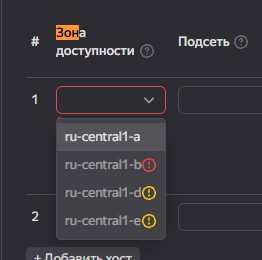
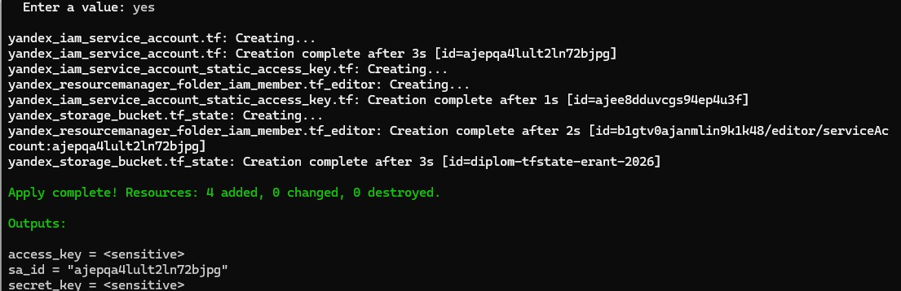
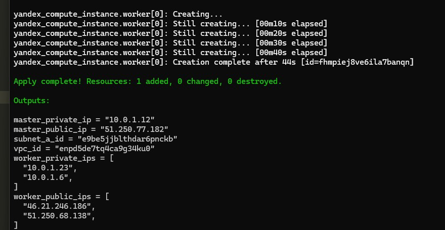
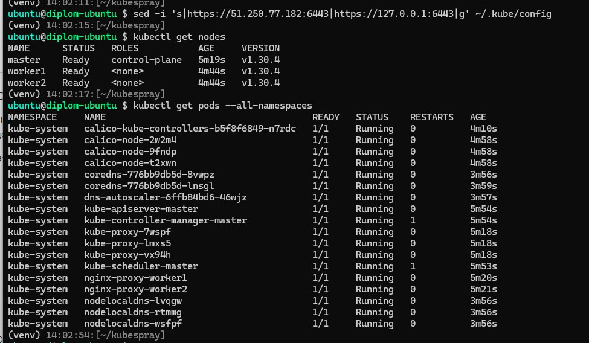
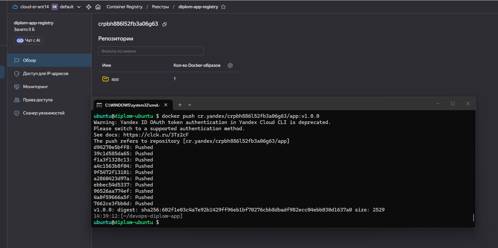
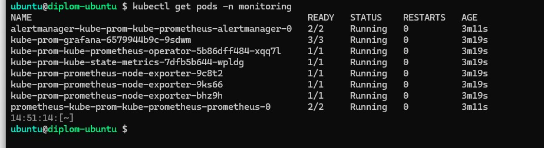
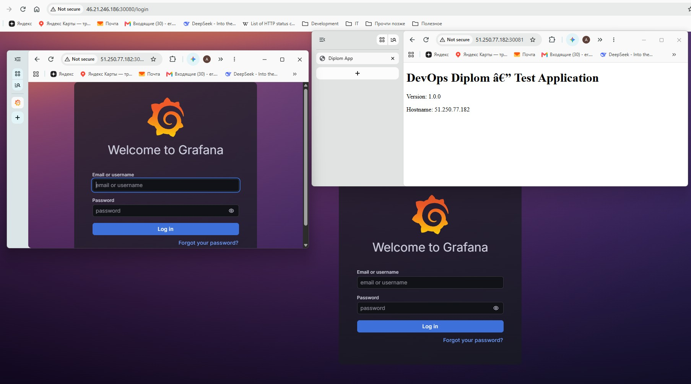
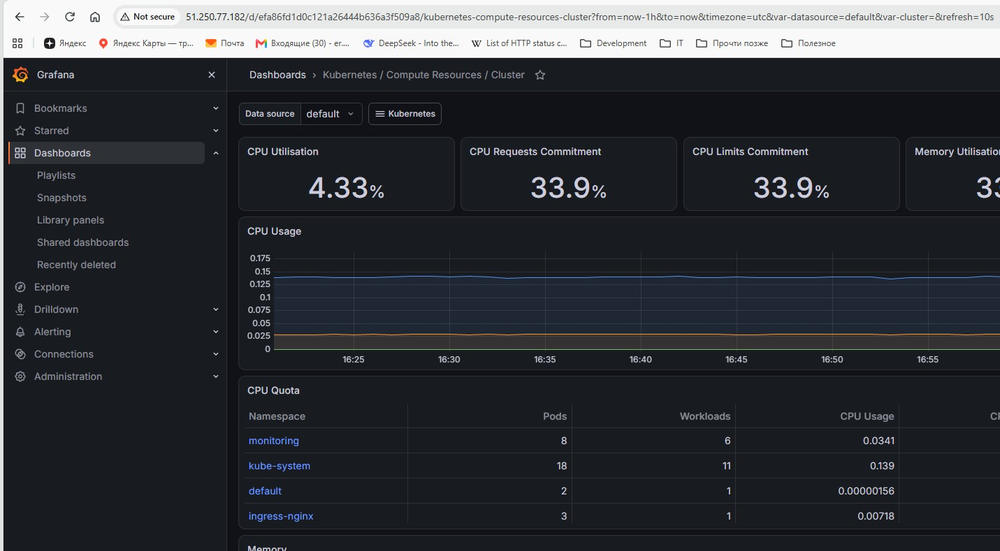
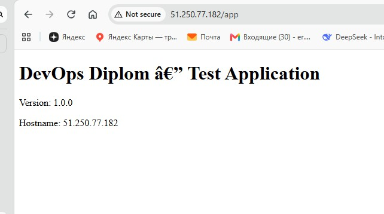
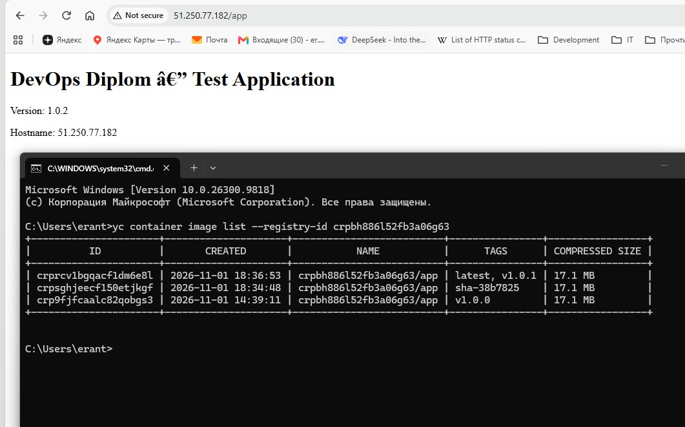

# devops-diplom

## 1. Terraform

Денег оставалось мало, и в целом были проблемы с доступностью у яндекса.

Растянул выполнение дипломной, в итоге сервера разбомбили :)

Поднял бекенд:

Поднял остальную инфру:

Поднял свои машины для k8s кластера (были проблемы с поднятием второго варианта из-за доступности зон)

Из ручных действий было только прокидывание ключей бакета в инфраструктуру.

## 2. K8S cluster

Делал через ansible - [инвентори который загружал в Kubespray](https://github.com/erant-netology-courses/devops-diplom/tree/main/ansible/inventory/mycluster). Подставлял вручную IP.

Все поднялось:

## 3. Test App

[Репозиторий с приложением.](https://github.com/erant-netology-courses/devops-diplom-app)

Использовал Yandex registry:

## 4. Monitoring

[Манифесты k8s тут.](https://github.com/erant-netology-courses/devops-diplom/tree/main/k8s) Но ставил через Helm, поэтому секреты и некоторые другие вещи создавал вручную

Все нужное по мониторингу задеплоилось:

Все работает:

Обновил порты с 30080 на 80, видно на этом дашборде графаны в пути:

## 5. Final

Использовал Github Actions. [Ссылка для приложения](https://github.com/erant-netology-courses/devops-diplom-app/actions) и [для инфраструктуры.](https://github.com/erant-netology-courses/devops-diplom/actions).

Вот до прохождения пайплайнов:

Вот после прохождения пайплайнов, еще и yc registry:

